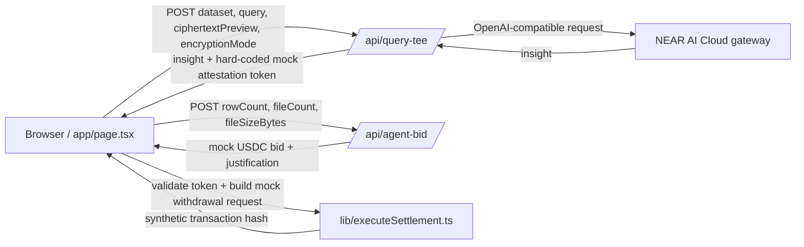

# BlindSight Architecture and Codebase Report

**Snapshot:** 2026-10-27

## Project Structure

The current source-level tree, including the autonomous agent bidding feature and judge-facing documentation, is:

```text
.
|-- .env.local                  # Local environment values; contents omitted
|-- .gitignore
|-- AGENTS.md
|-- ARCHITECTURE_REPORT.md
|-- HACKATHON.md
|-- README.md
|-- app/
|   |-- api/
|   |   |-- agent-bid/
|   |   |   `-- route.ts
|   |   `-- query-tee/
|   |       `-- route.ts
|   |-- favicon.ico
|   |-- globals.css
|   |-- layout.tsx
|   `-- page.tsx
|-- eslint.config.mjs
|-- lib/
|   `-- executeSettlement.ts
|-- next-env.d.ts
|-- next.config.ts
|-- package-lock.json
|-- package.json
|-- public/
|   |-- file.svg
|   |-- globe.svg
|   |-- next.svg
|   `-- vercel.svg
|-- tsconfig.json
`-- tsconfig.tsbuildinfo
```

The workspace also contains `.git/`, `.next/`, and `node_modules/`; these are repository metadata, generated Next.js output, and installed dependencies rather than application source.

## Architecture

BlindSight is a Next.js App Router application. The interactive experience is a single client-rendered page in [`app/page.tsx`](app/page.tsx). That page owns file intake, the encryption visualizer, the buyer's simulated escrow balance, query submission, and result/attestation rendering. Its server-side inference boundary is the `POST /api/query-tee` route in [`app/api/query-tee/route.ts`](app/api/query-tee/route.ts). The page delegates provider payout validation and mock settlement construction to [`lib/executeSettlement.ts`](lib/executeSettlement.ts).

`app/layout.tsx` provides the Geist font variables and document metadata. `app/globals.css` imports Tailwind CSS and sets the dark palette. `next.config.ts` enables `cacheComponents`, `partialPrefetching`, Turbopack CSS loading, and experimental `agentFeedback`. The package uses Next.js 16.4.3, React 19.3.0, Tailwind CSS 4, the OpenAI SDK, and Defuse Intents SDK types/dependency.



## `app/page.tsx`

### Client-Side Encryption Visualizer

The page stores uploaded files as `VaultFile` objects containing each filename, size, and text content. File contents are read with `file.text()`; accepted files are CSV, JSON, TXT, or TSV and must be under 1 MB each.

`handleEncryptPayload` starts a two-second animation. Every 40 ms, `randomCiphertextChunk` obtains random bytes with `window.crypto.getRandomValues`, maps them to alphanumeric characters, and appends the result to a preview capped at 2,400 characters. Only after the timer completes does the page set `vaultQueued` to true and render the green “Payload Encrypted (AES-256). Ready for TEE Transmission.” state. This is a random-character visualizer, **not AES-256 encryption**: it does not transform or encrypt the uploaded text.

On query submission the page includes `ciphertextPreview` and `encryptionMode: "mock-aes-256"` in the request body. The API route currently ignores both fields; the original `dataset` string is the value it forwards to inference. The vault UI explicitly labels this behavior as demo metadata. See [`app/page.tsx`](app/page.tsx#L18) and [`app/page.tsx`](app/page.tsx#L88).

### Buyer Deposit and Escrow Balance

`buyerBalance` begins at `0`; `isDepositing` controls the deposit loading state. `handleDeposit` waits 700 ms and sets the balance to 50 USDC. This is local UI state and a simulated transaction, not a wallet connection or token transfer. The button becomes disabled at 50 USDC.

The query handler and submit button both require an accepted bid and at least 10 USDC. After the API response contains both an insight and an attestation token, the page subtracts 10 USDC before invoking `executeDataPayout` with the accepted bid amount. Since the decrement occurs before payout completes, a later payout-helper error does not restore the balance. See [`app/page.tsx`](app/page.tsx#L47) and [`app/page.tsx`](app/page.tsx#L120).

### Autonomous Agent Bidding

Once the encryption preview is ready, the provider can request a valuation. The page estimates row counts from CSV/TSV lines, text lines, or JSON array entries, then posts row count, file count, and total file size to `/api/agent-bid`. The route validates the metadata and returns a deterministic quote at $0.05 per row with a generated explanation. The quote is mock pricing, not an external LLM result. The query stays disabled until the provider accepts the returned quote, and the accepted amount is used as the payout amount. Files cannot be changed while valuation is in flight, preventing a quote for stale metadata from being accepted.

### TEE Query and Attestation Badge

`handleSubmit` requires a non-empty prompt, attached files, completed local-preview step, at least 10 USDC, and no query already running. It joins file names and text into a dataset and rejects datasets over 60,000 characters, then POSTs to `/api/query-tee`. It validates the HTTP response and requires both `insight` and `attestationToken`, debits the buyer balance, and calls `executeDataPayout` with the provider destination, configured reward amount, and token. On success it renders the insight, token, synthetic settlement hash, and increments the run counter. Errors are shown in the request-failed alert.

The “Mock TEE attestation” panel is driven by whether `attestationToken` is non-empty. When present, it displays “Intel TDX / NVIDIA Hardware Verification: PASSED”; the adjacent copy correctly qualifies this as a mock prefix and says it is not hardware proof. The API currently returns a fixed mock token, so this badge is not a hardware verification. See [`app/page.tsx`](app/page.tsx#L120) and [`app/page.tsx`](app/page.tsx#L477).

## `app/api/query-tee/route.ts`

The route accepts JSON and validates that it contains non-empty string `dataset` and `query` fields. It enforces a 60,000-character dataset limit and a 2,000-character query limit, returning 400 for malformed/missing values and 413 for size violations. If `NEAR_AI_API_KEY` is absent, it returns 503.

It creates an OpenAI SDK client with `baseURL: "https://cloud-api.near.ai/v1"` and calls chat completions using model `zai-org/GLM-5.1-FP8`. Its user message contains both the dataset and research query. A successful response returns the model insight and the hard-coded token `mock_intel_tdx_token_8xJp2`; empty model content and upstream exceptions return 502 errors. The route reads only `dataset` and `query`, so the page's ciphertext preview and encryption mode are not used. The system prompt describes confidential-computing intent but explicitly notes that it is not itself proof of hardware isolation. See [`app/api/query-tee/route.ts`](app/api/query-tee/route.ts#L3) and [`app/api/query-tee/route.ts`](app/api/query-tee/route.ts#L32).

## `lib/executeSettlement.ts`

`executeDataPayout(dataProviderAddress, amountInUSDC, attestationToken)` performs these steps:

1. Checks that the token begins with `mock_intel_tdx`; otherwise throws “TEE attestation token was not accepted.” This is a string-prefix check, not cryptographic token verification.
2. Trims and validates the destination address as non-empty and no longer than 128 characters.
3. Parses the USDC amount using a decimal-only expression with no more than six fractional digits, converts it to six-decimal base units using `BigInt`, and rejects values at or below zero.
4. Constructs `WithdrawalParams` for `nep141:usdc.omft.near`, the base-unit amount, destination, and `feeInclusive: true`. It wraps this in a `ProcessWithdrawalArgs`-shaped object.
5. Does **not** call the Defuse SDK to submit a withdrawal. The constructed SDK request is explicitly discarded with `void sdkRequest`. The helper instead returns status `SETTLED` and a synthetic `mock-near-intent-<UUID>` transaction hash.

Consequently, Defuse is currently used for TypeScript parameter types and request-shape checking, not for an actual on-chain payout. The success UI also labels the hash as synthetic and states that no funds moved. See [`lib/executeSettlement.ts`](lib/executeSettlement.ts#L1) and [`lib/executeSettlement.ts`](lib/executeSettlement.ts#L23).

## `HACKATHON.md`

The root `HACKATHON.md` describes BlindSight's NEAR Hackathon Track 3 vision, the frontend / NEAR AI Cloud / NEAR settlement architecture, and the 14-day MVP constraints. It declares the encryption visualizer, attestation, buyer escrow, and payouts as mocks. It now also documents the autonomous agent bidding route and its fixed $0.05-per-row mock quote. The root `README.md` remains the standard create-next-app starter README.

## Requirements-Verification Notes

- **NEAR AI Cloud gateway/model:** Configured in the API route as requested; actual inference depends on the server-side `NEAR_AI_API_KEY`.
- **AES-256 encryption:** Not implemented. The current client animation generates random alphanumeric preview characters and labels this as a mock.
- **Encrypted inference payload:** Not implemented. The route sends the original dataset string to the NEAR AI Cloud model and ignores the preview fields.
- **Attestation:** Mock only. The API returns a fixed token and the client presents a corresponding mock badge.
- **USDC buyer funding:** Simulated local balance and delay only; no wallet transaction occurs.
- **Defuse payout:** Request parameters are constructed and typed, but the SDK is not invoked and no funds move.
- **Agent valuation:** `/api/agent-bid` derives a deterministic quote from row count at $0.05 per row; the justification is generated from metadata rather than an AI model.